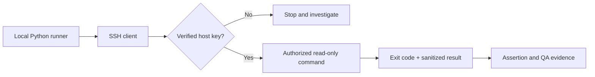

# SSH and Python Automation — Authorized Training Lab

SSH allows encrypted remote administration; it does **not** grant permission to access arbitrary hosts. Practice using your own VM or a specifically authorized sandbox, never a real service copied from an old course.

## Architecture



## Skills to learn

| Skill | Example scope | Safety requirement |
|---|---|---|
| Connection | Establish session to own test VM | Verify the expected host fingerprint |
| Authentication | SSH agent and protected keys | No plaintext password in scripts |
| Read-only inspection | `uname`, `pwd`, `df -h` | Explicit allowlist and user scope |
| File transfer | Upload a fictional test artifact | Target a disposable directory |
| Result checking | Parse exit code and stdout | Limit stored output; redact sensitive data |
| Error recovery | Retry a transient connection failure | Finite retries, no silent success |
| Deployment simulation | Copy a mock package to a sandbox | Not a production deploy or authorization |

## Paramiko reminder

Use `RejectPolicy()` or an appropriately managed known-hosts trust store; do **not** use `AutoAddPolicy()` as a convenient security bypass in a serious deployment. Establish host authenticity before sending credentials.

```python
# Illustration only: no host, username or credentials are configured.
import paramiko

client = paramiko.SSHClient()
client.load_system_host_keys()
client.set_missing_host_key_policy(paramiko.RejectPolicy())
# Connect only when host identity and authorization have been verified.
```

## QA exercise (no remote access required)

Mock an SSH execution result with `exit_status=0` and `stdout="demo-ok"`. Assert that a non-zero exit code causes test failure and that a connection timeout becomes `BLOCKED`, never `PASS`. Keep live network tests outside the public repository unless there is a specifically permitted sandbox.

## Legacy caution

Existing historical deployment code and configurations were not modified by this documentation update and are **not security-cleared**. Never reuse embedded sample hostnames, passwords or artifacts without independent verification. Potentially published credentials require rotation and history review in a separate approved cleanup.

**RU:** SSH/Paramiko для авторизованной автоматизации, проверки fingerprint, выполнения безопасных команд и QA на тестовой VM. Код из старых уроков не является инструкцией для production.

References: [OpenSSH](https://www.openssh.com/manual.html), [Paramiko](https://docs.paramiko.org/en/stable/).
